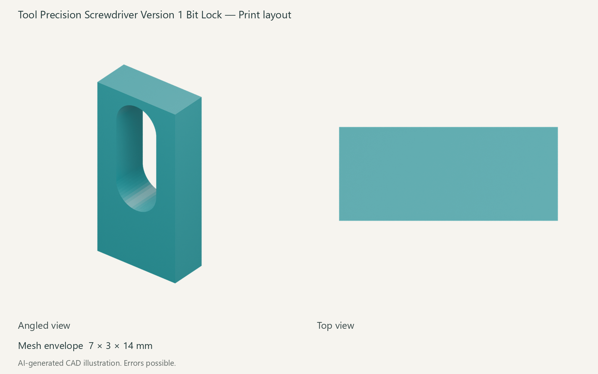

<!-- oobb-presentation:start -->
# OOBB precision screwdriver

AI-generated images and instructions. Errors possible.

## Summary

Precision screwdriver components, fit samples, labels and referenced purchased hardware.

This is an entirely AI-generated coding project. The generated outputs are included and usually work, but the main purpose of publishing it is to give others a starting point for modifying the project with their own AI tools.

[Example part](parts/tool_precision_screwdriver_version_1_bit_lock/)

## Details

This catalogue contains **79 records**. [Browse OOBB navigation](navigation_oobb/).

Each part has one canonical folder, its full OOMP ID and complete metadata. Navigation links open folders; use GitHub’s file pane to browse the available files.

[Build and maintenance guide](CATALOGUE_BUILD.md)

## Parts

Select the intended screwdriver generation and component. Purchased hardware records are clearly identified and do not receive invented printable meshes.

## Assembly

Follow the existing project guide and version-specific build notes for assembly and two-colour printing. Keep the selected generation’s mating parts together.

[Project guide and existing assembly notes](PROJECT_GUIDE.md)
<!-- oobb-presentation:end -->
