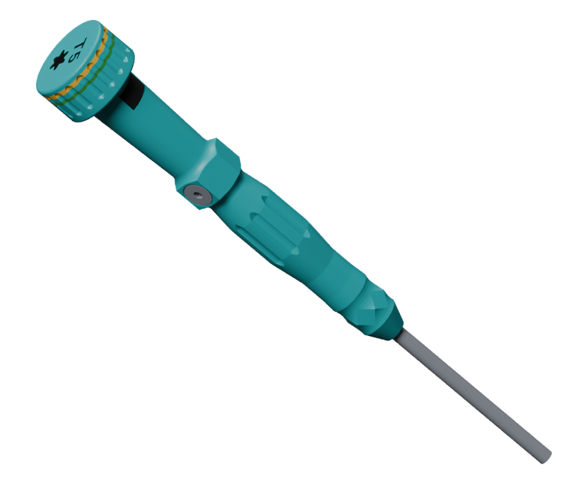
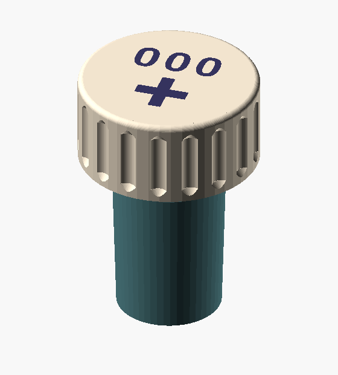
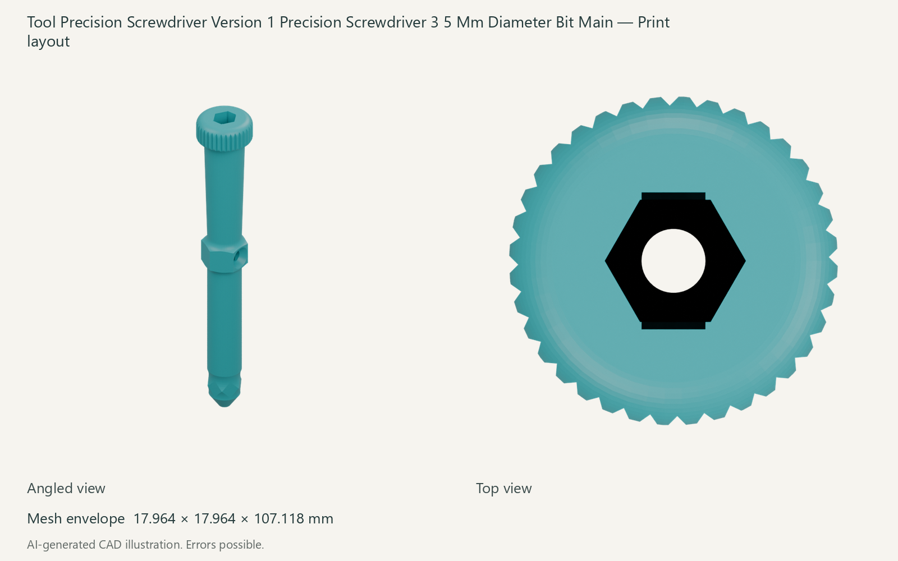

<!-- oobb-presentation:start -->
# OOBB precision screwdriver

A printable, bearing-capped handle for long quarter-inch hex bits. Choose the handle by the round shaft diameter and the cap by the drive marking. Each printable part includes STL and OpenSCAD files.

The Oomlout precision screwdriver is the starting design. Wera Kraftform Micro and the iFixit Precision Bit Driver informed the fingertip waist and grip texture. [Original screwdriver by Oomlout](https://github.com/oomlout/oomlout_oobb_tool_precision_screwdriver) · [Oomlout](https://github.com/oomlout)

[Choose a handle and cap](parts/version_3/README.md#choose-the-two-print-files) · [Four-step assembly](assembly/README.md)

This is an entirely AI-generated coding project. The source code is largely unreadable by humans, but usable generated files are included. It is published so others can use their own AI tools to understand, modify and regenerate the design.

AI-generated CAD images and instructions. Errors possible.

The dimensions and assembly clearances have been checked in CAD. The compact grip and the bearing press fit still need a physical trial.

| Image | Version and description | Main README | HTML assembly instructions | PDF download |
| --- | --- | --- | --- | --- |
|  | [Version 3](parts/version_3/README.md) · 101.6 mm capped, waisted grip and Torx labels | [Design and print files](parts/version_3/README.md) | [Standalone viewer](assembly/assembly_instructions.html) | [Landscape A4 PDF](assembly/assembly_instructions.pdf) |
|  | [Version 2](archive/v1-v2/VERSION_2_BUILD.md) · First 606 bearing assembly, 111.6 mm nose to palm | [Archived design](archive/v1-v2/VERSION_2_BUILD.md) | — | — |
|  | [Version 1](archive/v1-v2/navigation_oobb/tool_precision_screwdriver/version_1/README.md) · Original plug-style topper and handle | [Archived design](archive/v1-v2/navigation_oobb/tool_precision_screwdriver/version_1/README.md) | — | — |

[Browse handles and caps](navigation_oobb/tool_precision_screwdriver/version_3/) · [CAD build and maintenance](CATALOGUE_BUILD.md) · [Archive](archive/README.md)
<!-- oobb-presentation:end -->
