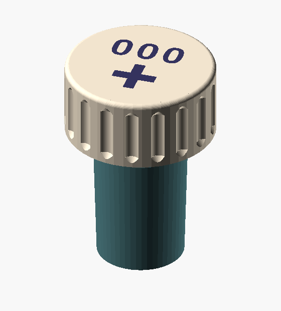

# Building the 606-bearing precision screwdriver

Print one [handle plate](navigation_oobb/tool_precision_screwdriver/version_2/precision_screwdriver) and one [label plate](navigation_oobb/tool_precision_screwdriver/version_2/label_top). The handle plate contains the handle, slotted lock key, side-loading nut cradle and a loose bearing-lift spacer, from left to right. The label plate contains the labelled bearing sheath, an identical spare spacer and the countersunk insert. Fit one spacer per screwdriver. The nut cradle is already lying on its flat side on both print plates. The [bearing mount plate](parts/tool_precision_screwdriver_version_2_bearing_mount/3dpr.stl) is available for replacement parts.

[Section through the centre screw, insert and nut cradle](assembly_version_2_section.png)

The illustration shows the rear of the handle. Open the [assembly drawing](assembly_version_2.scad) in OpenSCAD and set `exploded = 1` to separate the parts. Set `section = true` to inspect the inside or `show_full_handle = true` to see the spanner lands and grip.

## Hardware for one assembly

| Location | Hardware | Function |
| --- | --- | --- |
| Palm cap | One 606 bearing, 6 mm bore × 17 mm OD × 6 mm wide | Outer ring turns with the cover. The sleeve and countersunk insert clamp the inner ring. |
| Palm cap | One M3 × 16 mm 90° countersunk screw, one ordinary M3 hex nut, nominally 5.5 mm across flats and 2.4 mm thick | Screw length is measured over the head. The nut loads sideways into a removable shuttle. |
| Bit lock | The original M3 × 6 mm countersunk screw and its mating M3 nut | Passes through the separate slotted key at the central spanner land. |

The 16.7 mm diameter flare ends in a flat print-bed face around the bit-loading hole. The side-loading cradle ends 0.65 mm below the start of the flare, and its plain curved face follows the shaft taper. The round rear mouth continues directly to the cradle. Its hidden end has a 4.4 mm wide tongue that extends 1.35 mm beyond its shoulders and seats in a blind pocket in the far wall. The 2.55 mm high nut slot opens across the full 7.2 mm cradle width through the nut position. The curved front joins the two rails. The screw draws the nut into the hex seat above the slot.

Fit the lifter with its **chamfered 8.45 mm spigot pointing into the handle**. It enters the existing 8.8 mm loading hole by 1.5 mm (0.35 mm nominal diametral clearance). Its 10.5 mm shoulder stops on the flat handle face. At the opposite end, the 8 mm land supports the bearing's inner ring 1.4 mm above the handle.

The M3 screw seats in a single printed insert fitted from the top of the bearing. Its 5.8 mm diameter stem enters 5.75 mm into the 606's 6 mm bore, leaving 0.25 mm to the lifter. The 8 mm flange stands 1.0 mm above the bearing. That leaves about 0.48 mm of plastic at the transition from the 90° countersink into the stem for a screw head up to 6.72 mm across.

The rounded cap has a closed palm face with the size above the drive symbol. Its 17.07 mm socket (0.07 mm nominal diametral clearance on the 606) has a chamfered entry and a continuous internal lip with a 15 mm opening. The lip seats on the outer runner and the pocket roof clears the stationary insert by 0.45 mm. Even under the single-colour engraving there is 0.65 mm of face material. The installed palm face is 10.1 mm above the flat end of the handle. The 11.25 mm cap extends 1.15 mm down over the flare. Its 18.0 mm inside skirt diameter gives at least 0.65 mm radial clearance to the flare through a full turn. Use the revised handle and cap together. To adjust the fit for a printer, increase `bearing_fit_allowance` in `get_label_top_version_2` by 0.05 mm to open the diameter by 0.05 mm. [NSK bearing dimensions and shoulders](https://www.nsk.com/content/dam/nsk/am/en_us/documents/bearings-americas/Bearing-and-Linear-Replacement-Guide.pdf) · [M3 countersunk screw dimensions](https://www.intafast.com/wp-content/uploads/2019/08/Din7991_ISO_10642.pdf)

## Print the cover in two colours

1. Open the chosen label folder. Select `3dpr_color_main.stl` and `3dpr_color_support.stl` together. Import them **as one object with two parts**, preserving their file coordinates.
2. Assign the sheath, sleeve and insert colour to **main** and the lettering colour to **support**. Support contains the visible digits and drive symbol. Assign it an ordinary coloured filament.
3. Keep the face down as supplied. The inlay occupies Z = 0–0.60 mm, or three layers with a 0.20 mm first layer and 0.20 mm subsequent layers. The bed finish becomes the palm face. For a one-colour engraved cover, print `3dpr.stl` on its own.

[Example PH000 body](parts/tool_precision_screwdriver_version_2_label_top_phillips_000_size/3dpr_color_main.stl) · [Matching PH000 accent](parts/tool_precision_screwdriver_version_2_label_top_phillips_000_size/3dpr_color_support.stl)

## Assemble from the bit toward the palm

1. Feed the long bit tip-first through the open rear of the handle. Insert the printed lock key into the rear passage with its long slot aligned to the transverse screw. Fit the side nut and countersunk screw and check lock and release.
2. With the nut lying flat and its thread pointing up, feed it edge-first through the hidden back of the cradle. Align the parallel flats with the slot walls. Slide the cradle into the shaft below the flare until the narrow tip seats in the opposite wall and the plain curved face sits flush. When the centre screw catches, it lifts the nut into the hex seat, behind a 0.55 mm retaining step.
3. Insert the lifter's chamfered spigot into the rear loading hole until its shoulder seats against the handle. Centre the 606 on the raised land with the one-piece insert passing down through its bore, countersink facing up.
4. Pass the M3 × 16 screw through the insert and lifter into the cradle nut. Tighten until the inner ring is secure. Check that the outer ring turns freely. With the socket square to the bearing, press the labelled cap on until the internal lip meets the outer ring. Check free rotation under palm pressure.
5. To service the bit, pull the cap straight off by its grip grooves, undo the screw, and lift out the insert, bearing and lifter. Nudge the cradle out through the open loading passage.

## First bench print

The [coupon plate](parts/tool_precision_screwdriver_version_2_fit_coupons/3dpr.stl) uses sections of the production handle drawing. Looking down on the supplied build coordinates with +X to the right, the row at Y = 0 contains the 2, 3.5 and 5 mm noses. The row at Y = 22 contains lock pockets with 0.30, 0.50 and 0.70 mm **total** allowance. The loose key is on the right. The production pocket starts at 0.50 mm and the nose wall starts at 0.95 mm.

Print the coupons with the filament and profile intended for the handles. Compare hand insertion, release and play with actual bits. Print one complete label plate before the full label set. Check whether the labelled socket holds the bearing by friction and turns freely after the centre screw is tightened. Compare lock play after 30 changes and cap retention after 100 loaded hand turns. The CAD and slicer checks below have run. These physical checks are open.

## Verification

Run `python verify_screwdriver_version_2.py` after `python action_make_scad.py` (trimesh, NumPy and manifold3d). It checks all four bodies on each handle plate and all three on each label plate, the nut entry and capture, the plain outside face, key fit, 10 and 13 mm across-flats sections, single-piece covers, the seven coupon bodies, bearing hardware clearances and the union of each pair of colours. Run `python verify_screwdriver.py` separately for the version 1 archive comparison.

PrusaSlicer 2.9.6 generated G-code for the 2, 3.5 and 5 mm handle plates, mount, coupons and PH000 cover using a 0.4 mm nozzle, 0.45 mm nominal extrusion width and 0.20 mm layers. A further PH000 slice assigned the registered body and accent to separate extruders and produced tool changes and extrusion for both colours.
