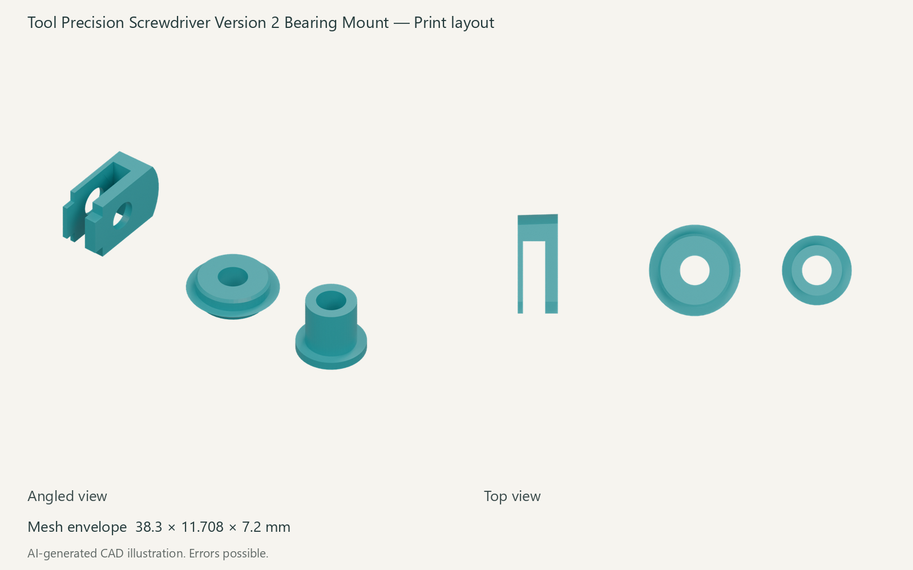

<!-- oobb-presentation:start -->
# Tool Precision Screwdriver Version 2 Bearing Mount

AI-generated images and instructions. Errors possible.

## Summary

Precision screwdriver components, fit samples, labels and referenced purchased hardware.

This is an entirely AI-generated coding project. The generated outputs are included and usually work, but the main purpose of publishing it is to give others a starting point for modifying the project with their own AI tools.



## Details

**Full OOMP ID:** `tool_precision_screwdriver_version_2_bearing_mount`

[Part folder](../../../../parts/tool_precision_screwdriver_version_2_bearing_mount/) · [OOBB navigation](../../../)

| Field | Value |
| --- | --- |
| Extra |  |
| Height | 1 |
| Oobb Name | bearing_mount |
| Oobb Type | bearing_mount_version_2 |
| Thickness | 6.75 |
| Width | 1 |
| Taxonomy | tool_precision_screwdriver / version_2 / bearing_mount |

<details>
<summary>Full part details: all working.yaml fields</summary>

```yaml
bip_39_2_word_array:
- alone
- hospital
bip_39_2_word_no_space: alonehospital
bip_39_2_word_space: alone hospital
bip_39_2_word_underscore: alone_hospital
bip_39_3_word_array:
- alone
- hospital
- summer
bip_39_3_word_no_space: alonehospitalsummer
bip_39_3_word_space: alone hospital summer
bip_39_3_word_underscore: alone_hospital_summer
bip_39_full_array:
- alone
- hospital
- summer
- extra
- release
- fortune
- arch
- approve
- kiwi
- acoustic
- craft
- entry
bip_39_full_no_space: alonehospitalsummerextrareleasefortunearchapprovekiwiacousticcraftentry
bip_39_full_space: alone hospital summer extra release fortune arch approve kiwi acoustic
  craft entry
bip_39_full_underscore: alone_hospital_summer_extra_release_fortune_arch_approve_kiwi_acoustic_craft_entry
classification: project
color: oomlout_oobb_tool_precision_screwdriver
description_extra: ''
description_main: bearing_mount_1_width_1_height_6.75_mm_depth
directory: parts/tool_precision_screwdriver_version_2_bearing_mount
id: tool_precision_screwdriver_version_2_bearing_mount
id_no_class: tool_precision_screwdriver_version_2_bearing_mount
id_no_size: tool_precision_screwdriver_version_2_bearing_mount
id_no_type: tool_precision_screwdriver_version_2_bearing_mount
id_oobb: tool_precision_screwdriver_version_2_bearing_mount
kwargs:
  extra: ''
  filter: ''
  generate_stl: false
  height: 1
  modes:
  - 3dpr
  - 'true'
  navigation: false
  oobb_name: bearing_mount
  oomp_mode: project
  oomp_run: false
  overwrite: true
  thickness: 6.75
  typ: fast
  width: 1
link_github: https://github.com/oomlout/oomlout_oomp_version_1_messy/tree/main/parts/tool_precision_screwdriver_version_2_bearing_mount
link_main: https://github.com/oomlout/oomlout_oomp_version_1_messy/tree/main/parts/tool_precision_screwdriver_version_2_bearing_mount
link_redirect: https://github.com/oomlout/oomlout_oomp_version_1_messy/tree/main/parts/tool_precision_screwdriver_version_2_bearing_mount
md5: 06edbf64a88b52b702c0567b6040c825
md5_10: 06edbf64a8
md5_10_upper: 06EDBF64A8
md5_5: 06edb
md5_5_upper: 06EDB
md5_6: 06edbf
md5_6_alpha: 9qdb
md5_6_alpha_upper: 9QDB
md5_6_upper: 06EDBF
name: Tool Precision Screwdriver Version 2 Bearing Mount
name_no_class: Tool Precision Screwdriver Version 2 Bearing Mount
name_no_size: Tool Precision Screwdriver Version 2 Bearing Mount
name_no_type: Tool Precision Screwdriver Version 2 Bearing Mount
name_proper: Tool Precision Screwdriver Version 2 Bearing Mount
name_space: tool precision screwdriver version 2 bearing mount
name_upper: TOOL PRECISION SCREWDRIVER VERSION 2 BEARING MOUNT
oobb_details:
  extra: ''
  height: 1
  oobb_name: bearing_mount
  oobb_type: bearing_mount_version_2
  run_scad: true
  run_solidcraft: false
  thickness: 6.75
  width: 1
oobb_name: bearing_mount
oomlout_ai_roboclick_1:
  actions:
  - command: text_jinja_template
    convert_to_pdf: false
    convert_to_png: false
    dict_data:
      classification: project
      color: oomlout_oobb_tool_precision_screwdriver
      description_extra: ''
      description_main: bearing_mount_1_width_1_height_6.75_mm_depth
      directory: parts\tool_precision_screwdriver_version_2_bearing_mount
      name: tool_precision_screwdriver_version_2_bearing_mount
      name_proper: Tool Precision Screwdriver Version 2 Bearing Mount
      name_space: tool precision screwdriver version 2 bearing mount
      name_upper: TOOL PRECISION SCREWDRIVER VERSION 2 BEARING MOUNT
      oobb_details:
        extra: ''
        height: 1
        oobb_name: bearing_mount
        oobb_type: bearing_mount_version_2
        run_scad: true
        run_solidcraft: false
        thickness: 6.75
        width: 1
      oobb_name: bearing_mount
      project_name: oomlout_oobb_tool_precision_screwdriver
      size: oomlout
      taxonomy_1: tool_precision_screwdriver
      taxonomy_10: ''
      taxonomy_11: ''
      taxonomy_12: ''
      taxonomy_13: ''
      taxonomy_14: ''
      taxonomy_15: ''
      taxonomy_2: version_2
      taxonomy_3: bearing_mount
      taxonomy_4: ''
      taxonomy_5: ''
      taxonomy_6: ''
      taxonomy_7: ''
      taxonomy_8: ''
      taxonomy_9: ''
      thickness: 6.75
      type: github
      url_chat: ''
    dict_data_files: {}
    dict_data_files_exists: {}
    file_output: label_oomp.svg
    file_template: C:\gh\oomlout_oobb_tool_precision_screwdriver_version_5\source_file\template_jinja\template_jinja_label_oomlout_76_2_mm_50_8_mm\working.svg.j2
    search_and_replace: []
  file_test: label_oomp.pdf
  retries_until_complete: 0
oomp_key: oomp_tool_precision_screwdriver_version_2_bearing_mount
project_name: oomlout_oobb_tool_precision_screwdriver
size: oomlout
taxonomy_1: tool_precision_screwdriver
taxonomy_10: ''
taxonomy_11: ''
taxonomy_12: ''
taxonomy_13: ''
taxonomy_14: ''
taxonomy_15: ''
taxonomy_1_capital: Tool Precision Screwdriver
taxonomy_1_first_letter: t
taxonomy_1_first_letter_upper: T
taxonomy_1_length_1: t
taxonomy_1_length_2: to
taxonomy_1_length_3: too
taxonomy_1_length_4: tool
taxonomy_1_length_5: tool_
taxonomy_1_upper: TOOL_PRECISION_SCREWDRIVER
taxonomy_1_upper_length_1: T
taxonomy_1_upper_length_2: TO
taxonomy_1_upper_length_3: TOO
taxonomy_1_upper_length_4: TOOL
taxonomy_1_upper_length_5: TOOL_
taxonomy_2: version_2
taxonomy_2_capital: Version 2
taxonomy_2_first_letter: v
taxonomy_2_first_letter_upper: V
taxonomy_2_length_1: v
taxonomy_2_length_2: ve
taxonomy_2_length_3: ver
taxonomy_2_length_4: vers
taxonomy_2_length_5: versi
taxonomy_2_upper: VERSION_2
taxonomy_2_upper_length_1: V
taxonomy_2_upper_length_2: VE
taxonomy_2_upper_length_3: VER
taxonomy_2_upper_length_4: VERS
taxonomy_2_upper_length_5: VERSI
taxonomy_3: bearing_mount
taxonomy_3_capital: Bearing Mount
taxonomy_3_first_letter: b
taxonomy_3_first_letter_upper: B
taxonomy_3_length_1: b
taxonomy_3_length_2: be
taxonomy_3_length_3: bea
taxonomy_3_length_4: bear
taxonomy_3_length_5: beari
taxonomy_3_upper: BEARING_MOUNT
taxonomy_3_upper_length_1: B
taxonomy_3_upper_length_2: BE
taxonomy_3_upper_length_3: BEA
taxonomy_3_upper_length_4: BEAR
taxonomy_3_upper_length_5: BEARI
taxonomy_4: ''
taxonomy_5: ''
taxonomy_6: ''
taxonomy_7: ''
taxonomy_8: ''
taxonomy_9: ''
thickness: 6.75
type: github
url_chat: ''
```

</details>

## Parts

Select the intended screwdriver generation and component. Purchased hardware records are clearly identified and do not receive invented printable meshes.

## Assembly

Follow the existing project guide and version-specific build notes for assembly and two-colour printing. Keep the selected generation’s mating parts together.

[Project guide and existing assembly notes](../../../../PROJECT_GUIDE.md)
<!-- oobb-presentation:end -->
