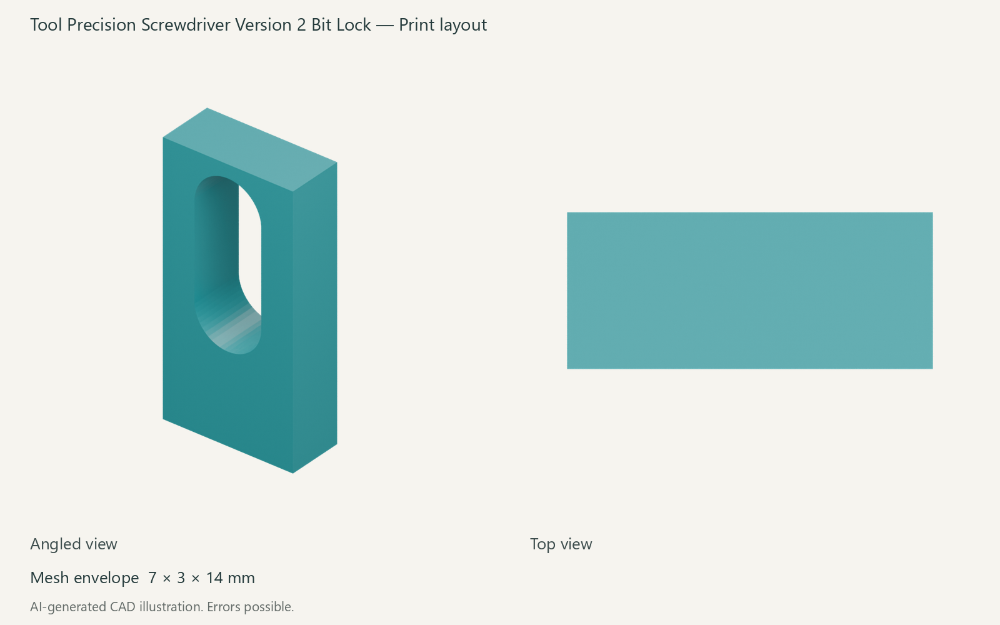

<!-- oobb-presentation:start -->
# Tool Precision Screwdriver Version 2 Bit Lock

AI-generated images and instructions. Errors possible.

## Summary

Precision screwdriver components, fit samples, labels and referenced purchased hardware.

This is an entirely AI-generated coding project. The generated outputs are included and usually work, but the main purpose of publishing it is to give others a starting point for modifying the project with their own AI tools.



## Details

**Full OOMP ID:** `tool_precision_screwdriver_version_2_bit_lock`

[Part folder](../../../../parts/tool_precision_screwdriver_version_2_bit_lock/) · [OOBB navigation](../../../)

| Field | Value |
| --- | --- |
| Extra |  |
| Height | 1 |
| Oobb Name | bit_lock |
| Oobb Type | bit_lock_version_2 |
| Thickness | 3 |
| Width | 1 |
| Taxonomy | tool_precision_screwdriver / version_2 / bit_lock |

<details>
<summary>Full part details: all working.yaml fields</summary>

```yaml
bip_39_2_word_array:
- fault
- song
bip_39_2_word_no_space: faultsong
bip_39_2_word_space: fault song
bip_39_2_word_underscore: fault_song
bip_39_3_word_array:
- fault
- song
- advance
bip_39_3_word_no_space: faultsongadvance
bip_39_3_word_space: fault song advance
bip_39_3_word_underscore: fault_song_advance
bip_39_full_array:
- fault
- song
- advance
- target
- fragile
- slice
- afford
- obtain
- oak
- business
- patrol
- three
bip_39_full_no_space: faultsongadvancetargetfragilesliceaffordobtainoakbusinesspatrolthree
bip_39_full_space: fault song advance target fragile slice afford obtain oak business
  patrol three
bip_39_full_underscore: fault_song_advance_target_fragile_slice_afford_obtain_oak_business_patrol_three
classification: project
color: oomlout_oobb_tool_precision_screwdriver
description_extra: ''
description_main: bit_lock_1_width_1_height_3_mm_depth
directory: parts/tool_precision_screwdriver_version_2_bit_lock
id: tool_precision_screwdriver_version_2_bit_lock
id_no_class: tool_precision_screwdriver_version_2_bit_lock
id_no_size: tool_precision_screwdriver_version_2_bit_lock
id_no_type: tool_precision_screwdriver_version_2_bit_lock
id_oobb: tool_precision_screwdriver_version_2_bit_lock
kwargs:
  extra: ''
  filter: bit_lock
  generate_stl: false
  height: 1
  modes:
  - 3dpr
  - 'true'
  navigation: false
  oobb_name: bit_lock
  oomp_mode: project
  oomp_run: false
  overwrite: true
  thickness: 3
  typ: fast
  width: 1
legacy_id: project_github_oomlout_oomlout_oobb_tool_precision_screwdriver_bit_lock_1_width_1_height_3_mm_depth
link_github: https://github.com/oomlout/oomlout_oomp_version_1_messy/tree/main/parts/tool_precision_screwdriver_version_2_bit_lock
link_main: https://github.com/oomlout/oomlout_oomp_version_1_messy/tree/main/parts/tool_precision_screwdriver_version_2_bit_lock
link_redirect: https://github.com/oomlout/oomlout_oomp_version_1_messy/tree/main/parts/tool_precision_screwdriver_version_2_bit_lock
md5: 53f9e40feef5c796c11cc497c3e284f0
md5_10: 53f9e40fee
md5_10_upper: 53F9E40FEE
md5_5: 53f9e
md5_5_upper: 53F9E
md5_6: 53f9e4
md5_6_alpha: 39yhw
md5_6_alpha_upper: 39YHW
md5_6_upper: 53F9E4
name: Tool Precision Screwdriver Version 2 Bit Lock
name_no_class: Tool Precision Screwdriver Version 2 Bit Lock
name_no_size: Tool Precision Screwdriver Version 2 Bit Lock
name_no_type: Tool Precision Screwdriver Version 2 Bit Lock
name_proper: Tool Precision Screwdriver Version 2 Bit Lock
name_space: tool precision screwdriver version 2 bit lock
name_upper: TOOL PRECISION SCREWDRIVER VERSION 2 BIT LOCK
oobb_details:
  extra: ''
  height: 1
  oobb_name: bit_lock
  oobb_type: bit_lock_version_2
  run_scad: true
  run_solidcraft: false
  thickness: 3
  width: 1
oobb_name: bit_lock
oomlout_ai_roboclick_1:
  actions:
  - command: text_jinja_template
    convert_to_pdf: false
    convert_to_png: false
    dict_data:
      classification: project
      color: oomlout_oobb_tool_precision_screwdriver
      description_extra: ''
      description_main: bit_lock_1_width_1_height_3_mm_depth
      directory: parts\tool_precision_screwdriver_version_2_bit_lock
      legacy_id: project_github_oomlout_oomlout_oobb_tool_precision_screwdriver_bit_lock_1_width_1_height_3_mm_depth
      name: tool_precision_screwdriver_version_2_bit_lock
      name_proper: Tool Precision Screwdriver Version 2 Bit Lock
      name_space: tool precision screwdriver version 2 bit lock
      name_upper: TOOL PRECISION SCREWDRIVER VERSION 2 BIT LOCK
      oobb_details:
        extra: ''
        height: 1
        oobb_name: bit_lock
        oobb_type: bit_lock_version_2
        run_scad: true
        run_solidcraft: false
        thickness: 3
        width: 1
      oobb_name: bit_lock
      project_name: oomlout_oobb_tool_precision_screwdriver
      size: oomlout
      taxonomy_1: tool_precision_screwdriver
      taxonomy_10: ''
      taxonomy_11: ''
      taxonomy_12: ''
      taxonomy_13: ''
      taxonomy_14: ''
      taxonomy_15: ''
      taxonomy_2: version_2
      taxonomy_3: bit_lock
      taxonomy_4: ''
      taxonomy_5: ''
      taxonomy_6: ''
      taxonomy_7: ''
      taxonomy_8: ''
      taxonomy_9: ''
      thickness: 3
      type: github
      url_chat: ''
    dict_data_files: {}
    dict_data_files_exists: {}
    file_output: label_oomp.svg
    file_template: C:\gh\oomlout_oobb_tool_precision_screwdriver_version_5\source_file\template_jinja\template_jinja_label_oomlout_76_2_mm_50_8_mm\working.svg.j2
    search_and_replace: []
  file_test: label_oomp.pdf
  retries_until_complete: 0
oomp_key: oomp_tool_precision_screwdriver_version_2_bit_lock
project_name: oomlout_oobb_tool_precision_screwdriver
size: oomlout
taxonomy_1: tool_precision_screwdriver
taxonomy_10: ''
taxonomy_11: ''
taxonomy_12: ''
taxonomy_13: ''
taxonomy_14: ''
taxonomy_15: ''
taxonomy_1_capital: Tool Precision Screwdriver
taxonomy_1_first_letter: t
taxonomy_1_first_letter_upper: T
taxonomy_1_length_1: t
taxonomy_1_length_2: to
taxonomy_1_length_3: too
taxonomy_1_length_4: tool
taxonomy_1_length_5: tool_
taxonomy_1_upper: TOOL_PRECISION_SCREWDRIVER
taxonomy_1_upper_length_1: T
taxonomy_1_upper_length_2: TO
taxonomy_1_upper_length_3: TOO
taxonomy_1_upper_length_4: TOOL
taxonomy_1_upper_length_5: TOOL_
taxonomy_2: version_2
taxonomy_2_capital: Version 2
taxonomy_2_first_letter: v
taxonomy_2_first_letter_upper: V
taxonomy_2_length_1: v
taxonomy_2_length_2: ve
taxonomy_2_length_3: ver
taxonomy_2_length_4: vers
taxonomy_2_length_5: versi
taxonomy_2_upper: VERSION_2
taxonomy_2_upper_length_1: V
taxonomy_2_upper_length_2: VE
taxonomy_2_upper_length_3: VER
taxonomy_2_upper_length_4: VERS
taxonomy_2_upper_length_5: VERSI
taxonomy_3: bit_lock
taxonomy_3_capital: Bit Lock
taxonomy_3_first_letter: b
taxonomy_3_first_letter_upper: B
taxonomy_3_length_1: b
taxonomy_3_length_2: bi
taxonomy_3_length_3: bit
taxonomy_3_length_4: bit_
taxonomy_3_length_5: bit_l
taxonomy_3_upper: BIT_LOCK
taxonomy_3_upper_length_1: B
taxonomy_3_upper_length_2: BI
taxonomy_3_upper_length_3: BIT
taxonomy_3_upper_length_4: BIT_
taxonomy_3_upper_length_5: BIT_L
taxonomy_4: ''
taxonomy_5: ''
taxonomy_6: ''
taxonomy_7: ''
taxonomy_8: ''
taxonomy_9: ''
thickness: 3
type: github
url_chat: ''
```

</details>

## Parts

Select the intended screwdriver generation and component. Purchased hardware records are clearly identified and do not receive invented printable meshes.

## Assembly

Follow the existing project guide and version-specific build notes for assembly and two-colour printing. Keep the selected generation’s mating parts together.

[Project guide and existing assembly notes](../../../../PROJECT_GUIDE.md)
<!-- oobb-presentation:end -->
