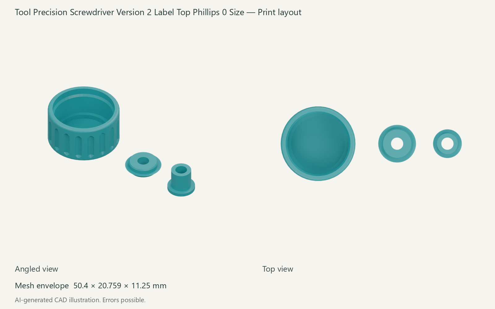

<!-- oobb-presentation:start -->
# Tool Precision Screwdriver Version 2 Label Top Phillips 0 Size

AI-generated images and instructions. Errors possible.

## Summary

Precision screwdriver components, fit samples, labels and referenced purchased hardware.

This is an entirely AI-generated coding project. The generated outputs are included and usually work, but the main purpose of publishing it is to give others a starting point for modifying the project with their own AI tools.



## Details

**Full OOMP ID:** `tool_precision_screwdriver_version_2_label_top_phillips_0_size`

[Part folder](../../../../../../parts/tool_precision_screwdriver_version_2_label_top_phillips_0_size/) · [OOBB navigation](../../../../../)

| Field | Value |
| --- | --- |
| Extra | phillips_shape_0_size |
| Height | 1 |
| Oobb Name | label_top |
| Oobb Type | label_top_version_2 |
| Shape | phillips |
| Siz | 0 |
| Thickness | 11.25 |
| Width | 1 |
| Taxonomy | tool_precision_screwdriver / version_2 / label_top / phillips / 0_size |

<details>
<summary>Full part details: all working.yaml fields</summary>

```yaml
bip_39_2_word_array:
- weasel
- uncover
bip_39_2_word_no_space: weaseluncover
bip_39_2_word_space: weasel uncover
bip_39_2_word_underscore: weasel_uncover
bip_39_3_word_array:
- weasel
- uncover
- life
bip_39_3_word_no_space: weaseluncoverlife
bip_39_3_word_space: weasel uncover life
bip_39_3_word_underscore: weasel_uncover_life
bip_39_full_array:
- weasel
- uncover
- life
- birth
- eight
- depth
- pass
- crew
- cinnamon
- bacon
- segment
- pulse
bip_39_full_no_space: weaseluncoverlifebirtheightdepthpasscrewcinnamonbaconsegmentpulse
bip_39_full_space: weasel uncover life birth eight depth pass crew cinnamon bacon
  segment pulse
bip_39_full_underscore: weasel_uncover_life_birth_eight_depth_pass_crew_cinnamon_bacon_segment_pulse
classification: project
color: oomlout_oobb_tool_precision_screwdriver
color_parts:
- main
- support
description_extra: phillips_shape_0_size_extra
description_main: label_top_1_width_1_height_11.25_mm_depth
directory: parts/tool_precision_screwdriver_version_2_label_top_phillips_0_size
extra: phillips_shape_0_size
id: tool_precision_screwdriver_version_2_label_top_phillips_0_size
id_no_class: tool_precision_screwdriver_version_2_label_top_phillips_0_size
id_no_size: tool_precision_screwdriver_version_2_label_top_phillips_0_size
id_no_type: tool_precision_screwdriver_version_2_label_top_phillips_0_size
id_oobb: tool_precision_screwdriver_version_2_label_top_phillips_0_size
kwargs:
  extra: phillips_shape_0_size
  filter: ''
  generate_stl: false
  height: 1
  modes:
  - 3dpr
  - 'true'
  navigation: false
  oobb_name: label_top
  oomp_mode: project
  oomp_run: false
  overwrite: true
  shape: phillips
  siz: '0'
  thickness: 11.25
  typ: fast
  width: 1
legacy_id: project_github_oomlout_oomlout_oobb_tool_precision_screwdriver_label_top_1_width_1_height_1_5_mm_depth_phillips_shape_0_size_extra
link_github: https://github.com/oomlout/oomlout_oomp_version_1_messy/tree/main/parts/tool_precision_screwdriver_version_2_label_top_phillips_0_size
link_main: https://github.com/oomlout/oomlout_oomp_version_1_messy/tree/main/parts/tool_precision_screwdriver_version_2_label_top_phillips_0_size
link_redirect: https://github.com/oomlout/oomlout_oomp_version_1_messy/tree/main/parts/tool_precision_screwdriver_version_2_label_top_phillips_0_size
md5: f89d96050b546e7668299a29022b0cd6
md5_10: f89d96050b
md5_10_upper: F89D96050B
md5_5: f89d9
md5_5_upper: F89D9
md5_6: f89d96
md5_6_alpha: 9p7yu
md5_6_alpha_upper: 9P7YU
md5_6_upper: F89D96
name: Tool Precision Screwdriver Version 2 Label Top Phillips 0 Size
name_no_class: Tool Precision Screwdriver Version 2 Label Top Phillips 0 Size
name_no_size: Tool Precision Screwdriver Version 2 Label Top Phillips 0 Size
name_no_type: Tool Precision Screwdriver Version 2 Label Top Phillips 0 Size
name_proper: Tool Precision Screwdriver Version 2 Label Top Phillips 0 Size
name_space: tool precision screwdriver version 2 label top phillips 0 size
name_upper: TOOL PRECISION SCREWDRIVER VERSION 2 LABEL TOP PHILLIPS 0 SIZE
oobb_details:
  extra: phillips_shape_0_size
  height: 1
  oobb_name: label_top
  oobb_type: label_top_version_2
  run_scad: true
  run_solidcraft: false
  shape: phillips
  siz: '0'
  thickness: 11.25
  width: 1
oobb_name: label_top
oomlout_ai_roboclick_1:
  actions:
  - command: text_jinja_template
    convert_to_pdf: false
    convert_to_png: false
    dict_data:
      classification: project
      color: oomlout_oobb_tool_precision_screwdriver
      color_parts:
      - main
      - support
      description_extra: phillips_shape_0_size_extra
      description_main: label_top_1_width_1_height_11.25_mm_depth
      directory: parts\tool_precision_screwdriver_version_2_label_top_phillips_0_size
      extra: phillips_shape_0_size
      legacy_id: project_github_oomlout_oomlout_oobb_tool_precision_screwdriver_label_top_1_width_1_height_1_5_mm_depth_phillips_shape_0_size_extra
      name: tool_precision_screwdriver_version_2_label_top_phillips_0_size
      name_proper: Tool Precision Screwdriver Version 2 Label Top Phillips 0 Size
      name_space: tool precision screwdriver version 2 label top phillips 0 size
      name_upper: TOOL PRECISION SCREWDRIVER VERSION 2 LABEL TOP PHILLIPS 0 SIZE
      oobb_details:
        extra: phillips_shape_0_size
        height: 1
        oobb_name: label_top
        oobb_type: label_top_version_2
        run_scad: true
        run_solidcraft: false
        shape: phillips
        siz: '0'
        thickness: 11.25
        width: 1
      oobb_name: label_top
      project_name: oomlout_oobb_tool_precision_screwdriver
      shape: phillips
      siz: '0'
      size: oomlout
      taxonomy_1: tool_precision_screwdriver
      taxonomy_10: ''
      taxonomy_11: ''
      taxonomy_12: ''
      taxonomy_13: ''
      taxonomy_14: ''
      taxonomy_15: ''
      taxonomy_2: version_2
      taxonomy_3: label_top
      taxonomy_4: phillips
      taxonomy_5: 0_size
      taxonomy_6: ''
      taxonomy_7: ''
      taxonomy_8: ''
      taxonomy_9: ''
      thickness: 11.25
      type: github
      url_chat: ''
    dict_data_files: {}
    dict_data_files_exists: {}
    file_output: label_oomp.svg
    file_template: C:\gh\oomlout_oobb_tool_precision_screwdriver_version_5\source_file\template_jinja\template_jinja_label_oomlout_76_2_mm_50_8_mm\working.svg.j2
    search_and_replace: []
  file_test: label_oomp.pdf
  retries_until_complete: 0
oomp_key: oomp_tool_precision_screwdriver_version_2_label_top_phillips_0_size
project_name: oomlout_oobb_tool_precision_screwdriver
shape: phillips
siz: '0'
size: oomlout
taxonomy_1: tool_precision_screwdriver
taxonomy_10: ''
taxonomy_11: ''
taxonomy_12: ''
taxonomy_13: ''
taxonomy_14: ''
taxonomy_15: ''
taxonomy_1_capital: Tool Precision Screwdriver
taxonomy_1_first_letter: t
taxonomy_1_first_letter_upper: T
taxonomy_1_length_1: t
taxonomy_1_length_2: to
taxonomy_1_length_3: too
taxonomy_1_length_4: tool
taxonomy_1_length_5: tool_
taxonomy_1_upper: TOOL_PRECISION_SCREWDRIVER
taxonomy_1_upper_length_1: T
taxonomy_1_upper_length_2: TO
taxonomy_1_upper_length_3: TOO
taxonomy_1_upper_length_4: TOOL
taxonomy_1_upper_length_5: TOOL_
taxonomy_2: version_2
taxonomy_2_capital: Version 2
taxonomy_2_first_letter: v
taxonomy_2_first_letter_upper: V
taxonomy_2_length_1: v
taxonomy_2_length_2: ve
taxonomy_2_length_3: ver
taxonomy_2_length_4: vers
taxonomy_2_length_5: versi
taxonomy_2_upper: VERSION_2
taxonomy_2_upper_length_1: V
taxonomy_2_upper_length_2: VE
taxonomy_2_upper_length_3: VER
taxonomy_2_upper_length_4: VERS
taxonomy_2_upper_length_5: VERSI
taxonomy_3: label_top
taxonomy_3_capital: Label Top
taxonomy_3_first_letter: l
taxonomy_3_first_letter_upper: L
taxonomy_3_length_1: l
taxonomy_3_length_2: la
taxonomy_3_length_3: lab
taxonomy_3_length_4: labe
taxonomy_3_length_5: label
taxonomy_3_upper: LABEL_TOP
taxonomy_3_upper_length_1: L
taxonomy_3_upper_length_2: LA
taxonomy_3_upper_length_3: LAB
taxonomy_3_upper_length_4: LABE
taxonomy_3_upper_length_5: LABEL
taxonomy_4: phillips
taxonomy_4_capital: Phillips
taxonomy_4_first_letter: p
taxonomy_4_first_letter_upper: P
taxonomy_4_length_1: p
taxonomy_4_length_2: ph
taxonomy_4_length_3: phi
taxonomy_4_length_4: phil
taxonomy_4_length_5: phill
taxonomy_4_upper: PHILLIPS
taxonomy_4_upper_length_1: P
taxonomy_4_upper_length_2: PH
taxonomy_4_upper_length_3: PHI
taxonomy_4_upper_length_4: PHIL
taxonomy_4_upper_length_5: PHILL
taxonomy_5: 0_size
taxonomy_5_capital: 0 Size
taxonomy_5_first_letter: '0'
taxonomy_5_first_letter_upper: '0'
taxonomy_5_length_1: '0'
taxonomy_5_length_2: '0_'
taxonomy_5_length_3: 0_s
taxonomy_5_length_4: 0_si
taxonomy_5_length_5: 0_siz
taxonomy_5_upper: 0_SIZE
taxonomy_5_upper_length_1: '0'
taxonomy_5_upper_length_2: '0_'
taxonomy_5_upper_length_3: 0_S
taxonomy_5_upper_length_4: 0_SI
taxonomy_5_upper_length_5: 0_SIZ
taxonomy_6: ''
taxonomy_7: ''
taxonomy_8: ''
taxonomy_9: ''
thickness: 11.25
type: github
url_chat: ''
```

</details>

## Parts

Select the intended screwdriver generation and component. Purchased hardware records are clearly identified and do not receive invented printable meshes.

## Assembly

Follow the existing project guide and version-specific build notes for assembly and two-colour printing. Keep the selected generation’s mating parts together.

[Project guide and existing assembly notes](../../../../../../PROJECT_GUIDE.md)
<!-- oobb-presentation:end -->
