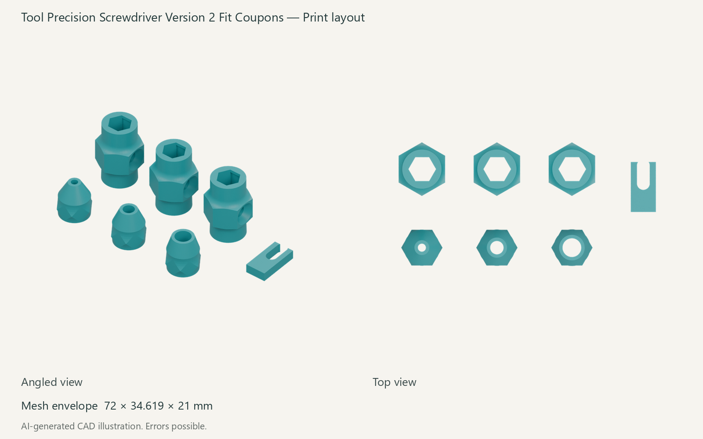

<!-- oobb-presentation:start -->
# Tool Precision Screwdriver Version 2 Fit Coupons

AI-generated images and instructions. Errors possible.

## Summary

Precision screwdriver components, fit samples, labels and referenced purchased hardware.

This is an entirely AI-generated coding project. The generated outputs are included and usually work, but the main purpose of publishing it is to give others a starting point for modifying the project with their own AI tools.



## Details

**Full OOMP ID:** `tool_precision_screwdriver_version_2_fit_coupons`

[Part folder](./) · [OOBB navigation](../../navigation_oobb/)

| Field | Value |
| --- | --- |
| Extra |  |
| Height | 1 |
| Oobb Name | fit_coupons |
| Oobb Type | fit_coupons_version_2 |
| Thickness | 21 |
| Width | 1 |
| Taxonomy | tool_precision_screwdriver / version_2 / fit_coupons |

<details>
<summary>Full part details: all working.yaml fields</summary>

```yaml
bip_39_2_word_array:
- elite
- poverty
bip_39_2_word_no_space: elitepoverty
bip_39_2_word_space: elite poverty
bip_39_2_word_underscore: elite_poverty
bip_39_3_word_array:
- elite
- poverty
- noise
bip_39_3_word_no_space: elitepovertynoise
bip_39_3_word_space: elite poverty noise
bip_39_3_word_underscore: elite_poverty_noise
bip_39_full_array:
- elite
- poverty
- noise
- wealth
- blue
- crazy
- hope
- green
- skin
- gospel
- open
- youth
bip_39_full_no_space: elitepovertynoisewealthbluecrazyhopegreenskingospelopenyouth
bip_39_full_space: elite poverty noise wealth blue crazy hope green skin gospel open
  youth
bip_39_full_underscore: elite_poverty_noise_wealth_blue_crazy_hope_green_skin_gospel_open_youth
classification: project
color: oomlout_oobb_tool_precision_screwdriver
description_extra: ''
description_main: fit_coupons_1_width_1_height_21_mm_depth
directory: parts/tool_precision_screwdriver_version_2_fit_coupons
id: tool_precision_screwdriver_version_2_fit_coupons
id_no_class: tool_precision_screwdriver_version_2_fit_coupons
id_no_size: tool_precision_screwdriver_version_2_fit_coupons
id_no_type: tool_precision_screwdriver_version_2_fit_coupons
id_oobb: tool_precision_screwdriver_version_2_fit_coupons
kwargs:
  extra: ''
  filter: ''
  generate_stl: false
  height: 1
  modes:
  - 3dpr
  - 'true'
  navigation: false
  oobb_name: fit_coupons
  oomp_mode: project
  oomp_run: false
  overwrite: true
  thickness: 21
  typ: fast
  width: 1
link_github: https://github.com/oomlout/oomlout_oomp_version_1_messy/tree/main/parts/tool_precision_screwdriver_version_2_fit_coupons
link_main: https://github.com/oomlout/oomlout_oomp_version_1_messy/tree/main/parts/tool_precision_screwdriver_version_2_fit_coupons
link_redirect: https://github.com/oomlout/oomlout_oomp_version_1_messy/tree/main/parts/tool_precision_screwdriver_version_2_fit_coupons
md5: 481522577c1184659b5b32ca8c9a6cff
md5_10: 481522577c
md5_10_upper: 481522577C
md5_5: '48152'
md5_5_upper: '48152'
md5_6: '481522'
md5_6_alpha: 2t92a
md5_6_alpha_upper: 2T92A
md5_6_upper: '481522'
name: Tool Precision Screwdriver Version 2 Fit Coupons
name_no_class: Tool Precision Screwdriver Version 2 Fit Coupons
name_no_size: Tool Precision Screwdriver Version 2 Fit Coupons
name_no_type: Tool Precision Screwdriver Version 2 Fit Coupons
name_proper: Tool Precision Screwdriver Version 2 Fit Coupons
name_space: tool precision screwdriver version 2 fit coupons
name_upper: TOOL PRECISION SCREWDRIVER VERSION 2 FIT COUPONS
oobb_details:
  extra: ''
  height: 1
  oobb_name: fit_coupons
  oobb_type: fit_coupons_version_2
  run_scad: true
  run_solidcraft: false
  thickness: 21
  width: 1
oobb_name: fit_coupons
oomlout_ai_roboclick_1:
  actions:
  - command: text_jinja_template
    convert_to_pdf: false
    convert_to_png: false
    dict_data:
      classification: project
      color: oomlout_oobb_tool_precision_screwdriver
      description_extra: ''
      description_main: fit_coupons_1_width_1_height_21_mm_depth
      directory: parts\tool_precision_screwdriver_version_2_fit_coupons
      name: tool_precision_screwdriver_version_2_fit_coupons
      name_proper: Tool Precision Screwdriver Version 2 Fit Coupons
      name_space: tool precision screwdriver version 2 fit coupons
      name_upper: TOOL PRECISION SCREWDRIVER VERSION 2 FIT COUPONS
      oobb_details:
        extra: ''
        height: 1
        oobb_name: fit_coupons
        oobb_type: fit_coupons_version_2
        run_scad: true
        run_solidcraft: false
        thickness: 21
        width: 1
      oobb_name: fit_coupons
      project_name: oomlout_oobb_tool_precision_screwdriver
      size: oomlout
      taxonomy_1: tool_precision_screwdriver
      taxonomy_10: ''
      taxonomy_11: ''
      taxonomy_12: ''
      taxonomy_13: ''
      taxonomy_14: ''
      taxonomy_15: ''
      taxonomy_2: version_2
      taxonomy_3: fit_coupons
      taxonomy_4: ''
      taxonomy_5: ''
      taxonomy_6: ''
      taxonomy_7: ''
      taxonomy_8: ''
      taxonomy_9: ''
      thickness: 21
      type: github
      url_chat: ''
    dict_data_files: {}
    dict_data_files_exists: {}
    file_output: label_oomp.svg
    file_template: C:\gh\oomlout_oobb_tool_precision_screwdriver_version_5\source_file\template_jinja\template_jinja_label_oomlout_76_2_mm_50_8_mm\working.svg.j2
    search_and_replace: []
  file_test: label_oomp.pdf
  retries_until_complete: 0
oomp_key: oomp_tool_precision_screwdriver_version_2_fit_coupons
project_name: oomlout_oobb_tool_precision_screwdriver
size: oomlout
taxonomy_1: tool_precision_screwdriver
taxonomy_10: ''
taxonomy_11: ''
taxonomy_12: ''
taxonomy_13: ''
taxonomy_14: ''
taxonomy_15: ''
taxonomy_1_capital: Tool Precision Screwdriver
taxonomy_1_first_letter: t
taxonomy_1_first_letter_upper: T
taxonomy_1_length_1: t
taxonomy_1_length_2: to
taxonomy_1_length_3: too
taxonomy_1_length_4: tool
taxonomy_1_length_5: tool_
taxonomy_1_upper: TOOL_PRECISION_SCREWDRIVER
taxonomy_1_upper_length_1: T
taxonomy_1_upper_length_2: TO
taxonomy_1_upper_length_3: TOO
taxonomy_1_upper_length_4: TOOL
taxonomy_1_upper_length_5: TOOL_
taxonomy_2: version_2
taxonomy_2_capital: Version 2
taxonomy_2_first_letter: v
taxonomy_2_first_letter_upper: V
taxonomy_2_length_1: v
taxonomy_2_length_2: ve
taxonomy_2_length_3: ver
taxonomy_2_length_4: vers
taxonomy_2_length_5: versi
taxonomy_2_upper: VERSION_2
taxonomy_2_upper_length_1: V
taxonomy_2_upper_length_2: VE
taxonomy_2_upper_length_3: VER
taxonomy_2_upper_length_4: VERS
taxonomy_2_upper_length_5: VERSI
taxonomy_3: fit_coupons
taxonomy_3_capital: Fit Coupons
taxonomy_3_first_letter: f
taxonomy_3_first_letter_upper: F
taxonomy_3_length_1: f
taxonomy_3_length_2: fi
taxonomy_3_length_3: fit
taxonomy_3_length_4: fit_
taxonomy_3_length_5: fit_c
taxonomy_3_upper: FIT_COUPONS
taxonomy_3_upper_length_1: F
taxonomy_3_upper_length_2: FI
taxonomy_3_upper_length_3: FIT
taxonomy_3_upper_length_4: FIT_
taxonomy_3_upper_length_5: FIT_C
taxonomy_4: ''
taxonomy_5: ''
taxonomy_6: ''
taxonomy_7: ''
taxonomy_8: ''
taxonomy_9: ''
thickness: 21
type: github
url_chat: ''
```

</details>

## Parts

Select the intended screwdriver generation and component. Purchased hardware records are clearly identified and do not receive invented printable meshes.

## Assembly

Follow the existing project guide and version-specific build notes for assembly and two-colour printing. Keep the selected generation’s mating parts together.

[Project guide and existing assembly notes](../../PROJECT_GUIDE.md)
<!-- oobb-presentation:end -->
