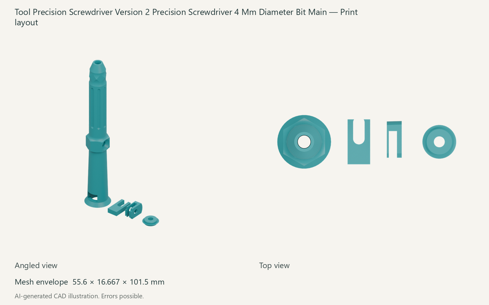

<!-- oobb-presentation:start -->
# Tool Precision Screwdriver Version 2 Precision Screwdriver 4 Mm Diameter Bit Main

AI-generated images and instructions. Errors possible.

## Summary

Precision screwdriver components, fit samples, labels and referenced purchased hardware.

This is an entirely AI-generated coding project. The generated outputs are included and usually work, but the main purpose of publishing it is to give others a starting point for modifying the project with their own AI tools.



## Details

**Full OOMP ID:** `tool_precision_screwdriver_version_2_precision_screwdriver_4_mm_diameter_bit_main`

[Part folder](./) · [OOBB navigation](../../navigation_oobb/)

| Field | Value |
| --- | --- |
| Diameter Bit Main | 4 |
| Extra | 4_mm_diameter_bit_main |
| Height | 1 |
| Oobb Name | precision_screwdriver |
| Oobb Type | precision_screwdriver_version_2 |
| Radius Bit Main | 2.0 |
| Thickness | 3 |
| Width | 1 |
| Taxonomy | tool_precision_screwdriver / version_2 / precision_screwdriver / 4_mm_diameter_bit_main |

<details>
<summary>Full part details: all working.yaml fields</summary>

```yaml
bip_39_2_word_array:
- parent
- discover
bip_39_2_word_no_space: parentdiscover
bip_39_2_word_space: parent discover
bip_39_2_word_underscore: parent_discover
bip_39_3_word_array:
- parent
- discover
- utility
bip_39_3_word_no_space: parentdiscoverutility
bip_39_3_word_space: parent discover utility
bip_39_3_word_underscore: parent_discover_utility
bip_39_full_array:
- parent
- discover
- utility
- doctor
- goat
- birth
- local
- barrel
- agent
- transfer
- laptop
- morning
bip_39_full_no_space: parentdiscoverutilitydoctorgoatbirthlocalbarrelagenttransferlaptopmorning
bip_39_full_space: parent discover utility doctor goat birth local barrel agent transfer
  laptop morning
bip_39_full_underscore: parent_discover_utility_doctor_goat_birth_local_barrel_agent_transfer_laptop_morning
classification: project
color: oomlout_oobb_tool_precision_screwdriver
description_extra: 4_mm_diameter_bit_main_extra
description_main: precision_screwdriver_1_width_1_height_3_mm_depth
diameter_bit_main: 4
directory: parts/tool_precision_screwdriver_version_2_precision_screwdriver_4_mm_diameter_bit_main
extra: 4_mm_diameter_bit_main
id: tool_precision_screwdriver_version_2_precision_screwdriver_4_mm_diameter_bit_main
id_no_class: tool_precision_screwdriver_version_2_precision_screwdriver_4_mm_diameter_bit_main
id_no_size: tool_precision_screwdriver_version_2_precision_screwdriver_4_mm_diameter_bit_main
id_no_type: tool_precision_screwdriver_version_2_precision_screwdriver_4_mm_diameter_bit_main
id_oobb: tool_precision_screwdriver_version_2_precision_screwdriver_4_mm_diameter_bit_main
kwargs:
  diameter_bit_main: 4
  extra: 4_mm_diameter_bit_main
  filter: ''
  generate_stl: false
  height: 1
  modes:
  - 3dpr
  - 'true'
  navigation: false
  oobb_name: precision_screwdriver
  oomp_mode: project
  oomp_run: false
  overwrite: true
  radius_bit_main: 2.0
  thickness: 3
  typ: fast
  width: 1
legacy_id: project_github_oomlout_oomlout_oobb_tool_precision_screwdriver_precision_screwdriver_1_width_1_height_3_mm_depth_4_mm_diameter_bit_main_extra
link_github: https://github.com/oomlout/oomlout_oomp_version_1_messy/tree/main/parts/tool_precision_screwdriver_version_2_precision_screwdriver_4_mm_diameter_bit_main
link_main: https://github.com/oomlout/oomlout_oomp_version_1_messy/tree/main/parts/tool_precision_screwdriver_version_2_precision_screwdriver_4_mm_diameter_bit_main
link_redirect: https://github.com/oomlout/oomlout_oomp_version_1_messy/tree/main/parts/tool_precision_screwdriver_version_2_precision_screwdriver_4_mm_diameter_bit_main
md5: a027dfc12026402d60d09604fce5f447
md5_10: a027dfc120
md5_10_upper: A027DFC120
md5_5: a027d
md5_5_upper: A027D
md5_6: a027df
md5_6_alpha: 68yqn
md5_6_alpha_upper: 68YQN
md5_6_upper: A027DF
name: Tool Precision Screwdriver Version 2 Precision Screwdriver 4 Mm Diameter Bit
  Main
name_no_class: Tool Precision Screwdriver Version 2 Precision Screwdriver 4 Mm Diameter
  Bit Main
name_no_size: Tool Precision Screwdriver Version 2 Precision Screwdriver 4 Mm Diameter
  Bit Main
name_no_type: Tool Precision Screwdriver Version 2 Precision Screwdriver 4 Mm Diameter
  Bit Main
name_proper: Tool Precision Screwdriver Version 2 Precision Screwdriver 4 Mm Diameter
  Bit Main
name_space: tool precision screwdriver version 2 precision screwdriver 4 mm diameter
  bit main
name_upper: TOOL PRECISION SCREWDRIVER VERSION 2 PRECISION SCREWDRIVER 4 MM DIAMETER
  BIT MAIN
oobb_details:
  diameter_bit_main: 4
  extra: 4_mm_diameter_bit_main
  height: 1
  oobb_name: precision_screwdriver
  oobb_type: precision_screwdriver_version_2
  radius_bit_main: 2.0
  run_scad: true
  run_solidcraft: false
  thickness: 3
  width: 1
oobb_name: precision_screwdriver
oomlout_ai_roboclick_1:
  actions:
  - command: text_jinja_template
    convert_to_pdf: false
    convert_to_png: false
    dict_data:
      classification: project
      color: oomlout_oobb_tool_precision_screwdriver
      description_extra: 4_mm_diameter_bit_main_extra
      description_main: precision_screwdriver_1_width_1_height_3_mm_depth
      diameter_bit_main: 4
      directory: parts\tool_precision_screwdriver_version_2_precision_screwdriver_4_mm_diameter_bit_main
      extra: 4_mm_diameter_bit_main
      legacy_id: project_github_oomlout_oomlout_oobb_tool_precision_screwdriver_precision_screwdriver_1_width_1_height_3_mm_depth_4_mm_diameter_bit_main_extra
      name: tool_precision_screwdriver_version_2_precision_screwdriver_4_mm_diameter_bit_main
      name_proper: Tool Precision Screwdriver Version 2 Precision Screwdriver 4 Mm
        Diameter Bit Main
      name_space: tool precision screwdriver version 2 precision screwdriver 4 mm
        diameter bit main
      name_upper: TOOL PRECISION SCREWDRIVER VERSION 2 PRECISION SCREWDRIVER 4 MM
        DIAMETER BIT MAIN
      oobb_details:
        diameter_bit_main: 4
        extra: 4_mm_diameter_bit_main
        height: 1
        oobb_name: precision_screwdriver
        oobb_type: precision_screwdriver_version_2
        radius_bit_main: 2.0
        run_scad: true
        run_solidcraft: false
        thickness: 3
        width: 1
      oobb_name: precision_screwdriver
      project_name: oomlout_oobb_tool_precision_screwdriver
      radius_bit_main: 2.0
      size: oomlout
      taxonomy_1: tool_precision_screwdriver
      taxonomy_10: ''
      taxonomy_11: ''
      taxonomy_12: ''
      taxonomy_13: ''
      taxonomy_14: ''
      taxonomy_15: ''
      taxonomy_2: version_2
      taxonomy_3: precision_screwdriver
      taxonomy_4: 4_mm_diameter_bit_main
      taxonomy_5: ''
      taxonomy_6: ''
      taxonomy_7: ''
      taxonomy_8: ''
      taxonomy_9: ''
      thickness: 3
      type: github
      url_chat: ''
    dict_data_files: {}
    dict_data_files_exists: {}
    file_output: label_oomp.svg
    file_template: C:\gh\oomlout_oobb_tool_precision_screwdriver_version_5\source_file\template_jinja\template_jinja_label_oomlout_76_2_mm_50_8_mm\working.svg.j2
    search_and_replace: []
  file_test: label_oomp.pdf
  retries_until_complete: 0
oomp_key: oomp_tool_precision_screwdriver_version_2_precision_screwdriver_4_mm_diameter_bit_main
project_name: oomlout_oobb_tool_precision_screwdriver
radius_bit_main: 2.0
size: oomlout
taxonomy_1: tool_precision_screwdriver
taxonomy_10: ''
taxonomy_11: ''
taxonomy_12: ''
taxonomy_13: ''
taxonomy_14: ''
taxonomy_15: ''
taxonomy_1_capital: Tool Precision Screwdriver
taxonomy_1_first_letter: t
taxonomy_1_first_letter_upper: T
taxonomy_1_length_1: t
taxonomy_1_length_2: to
taxonomy_1_length_3: too
taxonomy_1_length_4: tool
taxonomy_1_length_5: tool_
taxonomy_1_upper: TOOL_PRECISION_SCREWDRIVER
taxonomy_1_upper_length_1: T
taxonomy_1_upper_length_2: TO
taxonomy_1_upper_length_3: TOO
taxonomy_1_upper_length_4: TOOL
taxonomy_1_upper_length_5: TOOL_
taxonomy_2: version_2
taxonomy_2_capital: Version 2
taxonomy_2_first_letter: v
taxonomy_2_first_letter_upper: V
taxonomy_2_length_1: v
taxonomy_2_length_2: ve
taxonomy_2_length_3: ver
taxonomy_2_length_4: vers
taxonomy_2_length_5: versi
taxonomy_2_upper: VERSION_2
taxonomy_2_upper_length_1: V
taxonomy_2_upper_length_2: VE
taxonomy_2_upper_length_3: VER
taxonomy_2_upper_length_4: VERS
taxonomy_2_upper_length_5: VERSI
taxonomy_3: precision_screwdriver
taxonomy_3_capital: Precision Screwdriver
taxonomy_3_first_letter: p
taxonomy_3_first_letter_upper: P
taxonomy_3_length_1: p
taxonomy_3_length_2: pr
taxonomy_3_length_3: pre
taxonomy_3_length_4: prec
taxonomy_3_length_5: preci
taxonomy_3_upper: PRECISION_SCREWDRIVER
taxonomy_3_upper_length_1: P
taxonomy_3_upper_length_2: PR
taxonomy_3_upper_length_3: PRE
taxonomy_3_upper_length_4: PREC
taxonomy_3_upper_length_5: PRECI
taxonomy_4: 4_mm_diameter_bit_main
taxonomy_4_capital: 4 mm Diameter Bit Main
taxonomy_4_first_letter: '4'
taxonomy_4_first_letter_upper: '4'
taxonomy_4_length_1: '4'
taxonomy_4_length_2: '4_'
taxonomy_4_length_3: 4_m
taxonomy_4_length_4: 4_mm
taxonomy_4_length_5: 4_mm_
taxonomy_4_upper: 4_MM_DIAMETER_BIT_MAIN
taxonomy_4_upper_length_1: '4'
taxonomy_4_upper_length_2: '4_'
taxonomy_4_upper_length_3: 4_M
taxonomy_4_upper_length_4: 4_MM
taxonomy_4_upper_length_5: 4_MM_
taxonomy_5: ''
taxonomy_6: ''
taxonomy_7: ''
taxonomy_8: ''
taxonomy_9: ''
thickness: 3
type: github
url_chat: ''
```

</details>

## Parts

Select the intended screwdriver generation and component. Purchased hardware records are clearly identified and do not receive invented printable meshes.

## Assembly

Follow the existing project guide and version-specific build notes for assembly and two-colour printing. Keep the selected generation’s mating parts together.

[Project guide and existing assembly notes](../../PROJECT_GUIDE.md)
<!-- oobb-presentation:end -->
