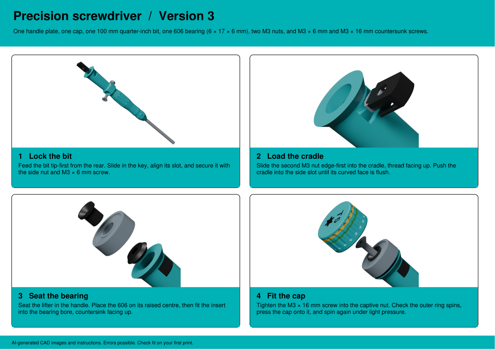

<!-- oobb-presentation:start -->
# Assemble the precision screwdriver

One handle plate, one cap, one 100 mm quarter-inch bit, one 606 bearing (6 × 17 × 6 mm), two M3 nuts, and M3 × 6 mm and M3 × 16 mm countersunk screws.

[Open the illustrated sheet](assembly_instructions.html) · [Print the single-page PDF](assembly_instructions.pdf) · [Parts list](parts.csv)

## Assembly

1. **[Lock the bit](render/raw/step_01.png).** Feed the bit tip-first from the rear. Slide in the key, align its slot, and secure it with the side nut and M3 × 6 mm screw.
2. **[Load the cradle](render/raw/step_02.png).** Slide the second M3 nut edge-first into the cradle, thread facing up. Push the cradle into the side slot until its curved face is flush.
3. **[Seat the bearing](render/raw/step_03.png).** Seat the lifter in the handle. Place the 606 on its raised centre, then fit the insert into the bearing bore, countersink facing up.
4. **[Fit the cap](render/raw/step_04.png).** Tighten the M3 × 16 mm screw into the captive nut. Check the outer ring spins, press the cap onto it, and spin again under light pressure.

AI-generated CAD images and instructions. Errors possible.

[Choose print files](../parts/version_3/README.md) · [Project](../README.md)
<!-- oobb-presentation:end -->
