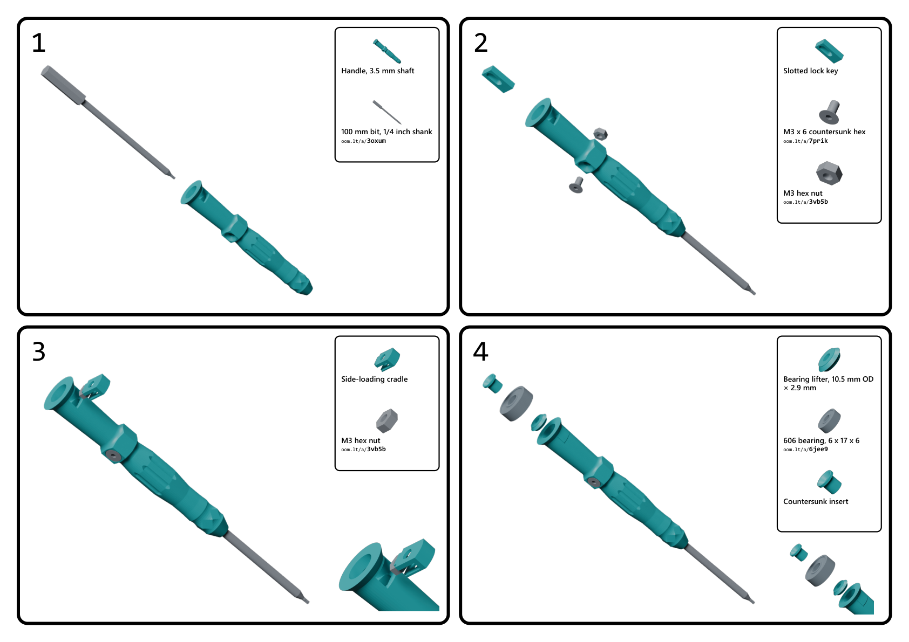
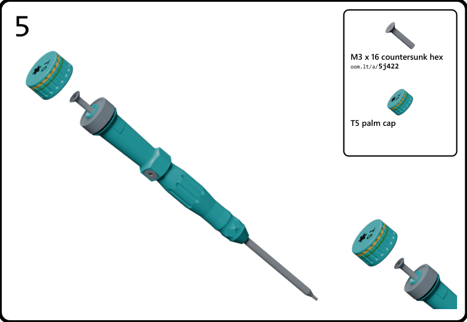

<!-- oobb-presentation:start -->
# Assemble the precision screwdriver

One handle plate, one cap, one 100 mm quarter-inch bit, one 606 bearing (6 × 17 × 6 mm), two M3 nuts, and M3 × 6 mm and M3 × 16 mm countersunk screws.

[Open the offline viewer](assembly_instructions.html) · [Download the landscape A4 booklet](assembly_instructions.pdf) · [Parts list](parts.csv)

## Assembly

1. **[Slide in the driver bit](cards/step_01.png).** Feed the bit tip-first through the open bearing end. Slide it in until the hex shank seats and the tip projects from the nose.
2. **[Lock the bit](cards/step_02.png).** Slide the lock key in behind the bit. Align its slot with the side hole, fit the side nut and tighten the M3 × 6 mm countersunk screw.
3. **[Load the cradle](cards/step_03.png).** Slide the second M3 nut edge-first into the cradle, thread facing up. Push the cradle into the side slot until its curved face is flush.
4. **[Seat the bearing](cards/step_04.png).** Seat the lifter in the handle. Place the 606 on its raised centre, then fit the insert into the bearing bore, countersink facing up.
5. **[Fit the cap](cards/step_05.png).** Tighten the M3 × 16 mm screw into the captive nut. Check the outer ring spins, press the cap onto it, and spin again under light pressure.

AI-generated CAD images and instructions. Errors possible.

[Choose print files](../parts/version_3/README.md) · [Project](../README.md)
<!-- oobb-presentation:end -->
