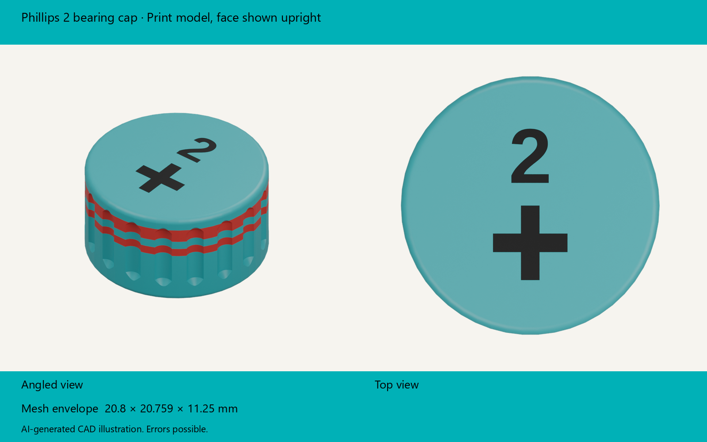

<!-- oobb-presentation:start -->
# Phillips 2 bearing cap

A closed, marked palm cap with a 17.07 mm seat for the 606 bearing. Fits every version 3 shaft diameter.



AI-generated images and instructions. Errors possible.

[Download the colour-banded cap (3MF)](../../../../../../parts/tool_precision_screwdriver_version_3_label_top_phillips_2_size/3dpr_banded.3mf)

Filaments (3): teal, black, red.

| Band from the palm face | Filament | Print Z (mm) |
| --- | --- | --- |
| Drive | Red | 1.4–3.0 |
| Digit 2 | Red | 4.0–5.0 |

Print face down. Assign teal to the shell and black to the marking. For a two-colour cap, import these two STLs together at their original coordinates.

[Teal shell STL](../../../../../../parts/tool_precision_screwdriver_version_3_label_top_phillips_2_size/3dpr_color_main.stl) · [Black marking STL](../../../../../../parts/tool_precision_screwdriver_version_3_label_top_phillips_2_size/3dpr_color_support.stl)

[Single-colour engraved STL](../../../../../../parts/tool_precision_screwdriver_version_3_label_top_phillips_2_size/3dpr.stl)

[Shared assembly guide](../../../../../../assembly/README.md) · [Choose handles and caps](../../../../../../parts/version_3/README.md)

**OOMP ID**  
`tool_precision_screwdriver_version_3_label_top_phillips_2_size`

[Full part definition (YAML)](../../../../../../parts/tool_precision_screwdriver_version_3_label_top_phillips_2_size/working.yaml)

[Part folder](../../../../../../parts/tool_precision_screwdriver_version_3_label_top_phillips_2_size) · [OOBB navigation](../../../../..)

<details>
<summary>Full part metadata</summary>

```yaml
classification: project
color: oomlout_oobb_tool_precision_screwdriver
color_parts:
- main
- support
colour_bands:
- colour: red
  from_mm: 1.4
  hex: '#D32F2F'
  role: Drive
  to_mm: 3.0
- colour: red
  from_mm: 4.0
  hex: '#D32F2F'
  role: Digit 2
  to_mm: 5.0
description_extra: phillips_shape_2_size_extra
description_main: label_top_1_width_1_height_11.25_mm_depth
extra: phillips_shape_2_size
id: tool_precision_screwdriver_version_3_label_top_phillips_2_size
id_oobb: tool_precision_screwdriver_version_3_label_top_phillips_2_size
kwargs:
  extra: phillips_shape_2_size
  filter: version_3_label_top
  generate_stl: false
  height: 1
  modes:
  - 3dpr
  - 'true'
  navigation: false
  oobb_name: label_top
  oomp_mode: project
  oomp_run: false
  overwrite: true
  shape: phillips
  siz: '2'
  thickness: 11.25
  typ: fast
  width: 1
name_proper: Tool Precision Screwdriver Version 3 Label Top Phillips 2 Size
oobb_details:
  extra: phillips_shape_2_size
  height: 1
  oobb_name: label_top
  oobb_type: label_top_version_3
  run_scad: true
  run_solidcraft: false
  shape: phillips
  siz: '2'
  thickness: 11.25
  width: 1
oobb_name: label_top
project_name: oomlout_oobb_tool_precision_screwdriver
shape: phillips
siz: '2'
size: oomlout
taxonomy_1: tool_precision_screwdriver
taxonomy_10: ''
taxonomy_11: ''
taxonomy_12: ''
taxonomy_13: ''
taxonomy_14: ''
taxonomy_15: ''
taxonomy_2: version_3
taxonomy_3: label_top
taxonomy_4: phillips
taxonomy_5: 2_size
taxonomy_6: ''
taxonomy_7: ''
taxonomy_8: ''
taxonomy_9: ''
thickness: 11.25
type: github
```

</details>
<!-- oobb-presentation:end -->
