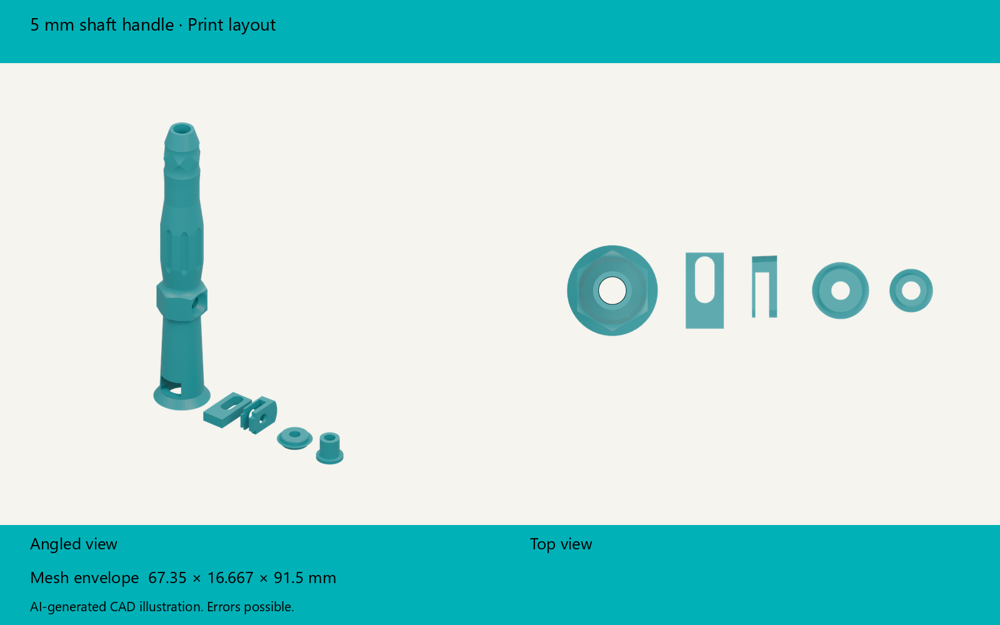

<!-- oobb-presentation:start -->
# Precision handle for a 5 mm bit shaft

A 91.5 mm handle with 10 and 13 mm spanner flats for long quarter-inch hex-shank bits.



AI-generated images and instructions. Errors possible.

[Download the teal handle plate (3MF)](3dpr_teal.3mf) · [Five-piece plate (STL)](3dpr.stl)

Print the body in teal. The plate includes the slotted key, side-loading nut cradle, bearing lifter and countersunk insert.

[Shared assembly guide](../../assembly/README.md) · [Choose handles and caps](../version_3/README.md)

**OOMP ID**  
`tool_precision_screwdriver_version_3_precision_screwdriver_5_mm_diameter_bit_main`

[Full part definition (YAML)](working.yaml)

[Part folder](.) · [OOBB navigation](../../navigation_oobb)

<details>
<summary>Full part metadata</summary>

```yaml
classification: project
color: oomlout_oobb_tool_precision_screwdriver
description_extra: 5_mm_diameter_bit_main_extra
description_main: precision_screwdriver_1_width_1_height_91.5_mm_depth
diameter_bit_main: 5
extra: 5_mm_diameter_bit_main
id: tool_precision_screwdriver_version_3_precision_screwdriver_5_mm_diameter_bit_main
id_oobb: tool_precision_screwdriver_version_3_precision_screwdriver_5_mm_diameter_bit_main
kwargs:
  diameter_bit_main: 5
  extra: 5_mm_diameter_bit_main
  filter: version_3_precision_screwdriver
  generate_stl: false
  height: 1
  modes:
  - 3dpr
  - 'true'
  navigation: false
  oobb_name: precision_screwdriver
  oomp_mode: project
  oomp_run: false
  overwrite: true
  radius_bit_main: 2.5
  thickness: 91.5
  typ: fast
  width: 1
name_proper: Tool Precision Screwdriver Version 3 Precision Screwdriver 5 Mm Diameter
  Bit Main
oobb_details:
  diameter_bit_main: 5
  extra: 5_mm_diameter_bit_main
  height: 1
  oobb_name: precision_screwdriver
  oobb_type: precision_screwdriver_version_3
  radius_bit_main: 2.5
  run_scad: true
  run_solidcraft: false
  thickness: 91.5
  width: 1
oobb_name: precision_screwdriver
project_name: oomlout_oobb_tool_precision_screwdriver
radius_bit_main: 2.5
size: oomlout
taxonomy_1: tool_precision_screwdriver
taxonomy_10: ''
taxonomy_11: ''
taxonomy_12: ''
taxonomy_13: ''
taxonomy_14: ''
taxonomy_15: ''
taxonomy_2: version_3
taxonomy_3: precision_screwdriver
taxonomy_4: 5_mm_diameter_bit_main
taxonomy_5: ''
taxonomy_6: ''
taxonomy_7: ''
taxonomy_8: ''
taxonomy_9: ''
thickness: 91.5
type: github
```

</details>
<!-- oobb-presentation:end -->
