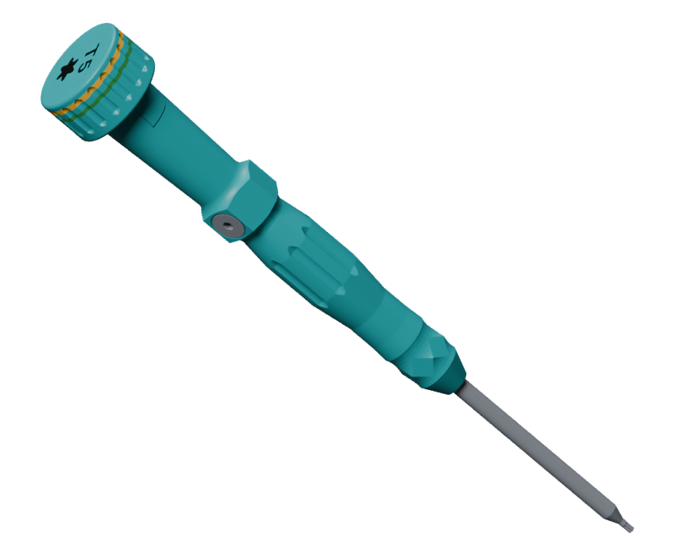

<!-- oobb-presentation:start -->
# Version 3 · compact bearing handle

[Project and previous versions](../../README.md)

The handle is 91.5 mm from nose to rear face. The fitted cap adds 10.1 mm. The 10 mm and 13 mm spanner lands and the quarter-inch bit lock remain at their original positions.

## Choose the two print files

Print one handle plate and one cap. Each handle plate contains the body, slotted key, side-loading nut cradle, bearing lifter and countersunk insert.

Measure the round shaft immediately above the bit tip. The quarter-inch hex shank is common to every handle.

**Handle shaft diameter (mm)**  
[2](../tool_precision_screwdriver_version_3_precision_screwdriver_2_mm_diameter_bit_main/) · [2.25](../tool_precision_screwdriver_version_3_precision_screwdriver_2_25_mm_diameter_bit_main/) · [2.5](../tool_precision_screwdriver_version_3_precision_screwdriver_2_5_mm_diameter_bit_main/) · [2.75](../tool_precision_screwdriver_version_3_precision_screwdriver_2_75_mm_diameter_bit_main/) · [3](../tool_precision_screwdriver_version_3_precision_screwdriver_3_mm_diameter_bit_main/) · [3.25](../tool_precision_screwdriver_version_3_precision_screwdriver_3_25_mm_diameter_bit_main/) · [3.5](../tool_precision_screwdriver_version_3_precision_screwdriver_3_5_mm_diameter_bit_main/) · [3.75](../tool_precision_screwdriver_version_3_precision_screwdriver_3_75_mm_diameter_bit_main/) · [4](../tool_precision_screwdriver_version_3_precision_screwdriver_4_mm_diameter_bit_main/) · [4.25](../tool_precision_screwdriver_version_3_precision_screwdriver_4_25_mm_diameter_bit_main/) · [4.5](../tool_precision_screwdriver_version_3_precision_screwdriver_4_5_mm_diameter_bit_main/) · [4.75](../tool_precision_screwdriver_version_3_precision_screwdriver_4_75_mm_diameter_bit_main/) · [5](../tool_precision_screwdriver_version_3_precision_screwdriver_5_mm_diameter_bit_main/)

| Cap marking | Sizes |
| --- | --- |
| Hex | [0.7](../tool_precision_screwdriver_version_3_label_top_hex_0_7_size/) · [0.9](../tool_precision_screwdriver_version_3_label_top_hex_0_9_size/) · [1.3](../tool_precision_screwdriver_version_3_label_top_hex_1_3_size/) · [1.5](../tool_precision_screwdriver_version_3_label_top_hex_1_5_size/) · [2](../tool_precision_screwdriver_version_3_label_top_hex_2_size/) · [2.5](../tool_precision_screwdriver_version_3_label_top_hex_2_5_size/) · [3](../tool_precision_screwdriver_version_3_label_top_hex_3_size/) · [3.5](../tool_precision_screwdriver_version_3_label_top_hex_3_5_size/) · [4](../tool_precision_screwdriver_version_3_label_top_hex_4_size/) · [5](../tool_precision_screwdriver_version_3_label_top_hex_5_size/) |
| Slotted | [0.8](../tool_precision_screwdriver_version_3_label_top_slotted_0_8_size/) · [1](../tool_precision_screwdriver_version_3_label_top_slotted_1_size/) · [1.2](../tool_precision_screwdriver_version_3_label_top_slotted_1_2_size/) · [1.5](../tool_precision_screwdriver_version_3_label_top_slotted_1_5_size/) · [1.8](../tool_precision_screwdriver_version_3_label_top_slotted_1_8_size/) · [2](../tool_precision_screwdriver_version_3_label_top_slotted_2_size/) · [2.5](../tool_precision_screwdriver_version_3_label_top_slotted_2_5_size/) · [3](../tool_precision_screwdriver_version_3_label_top_slotted_3_size/) · [4](../tool_precision_screwdriver_version_3_label_top_slotted_4_size/) |
| Phillips | [000](../tool_precision_screwdriver_version_3_label_top_phillips_000_size/) · [00](../tool_precision_screwdriver_version_3_label_top_phillips_00_size/) · [0](../tool_precision_screwdriver_version_3_label_top_phillips_0_size/) · [1](../tool_precision_screwdriver_version_3_label_top_phillips_1_size/) · [2](../tool_precision_screwdriver_version_3_label_top_phillips_2_size/) |
| Torx | [T2](../tool_precision_screwdriver_version_3_label_top_torx_t2_size/) · [T3](../tool_precision_screwdriver_version_3_label_top_torx_t3_size/) · [T4](../tool_precision_screwdriver_version_3_label_top_torx_t4_size/) · [T5](../tool_precision_screwdriver_version_3_label_top_torx_t5_size/) · [T6](../tool_precision_screwdriver_version_3_label_top_torx_t6_size/) · [T7](../tool_precision_screwdriver_version_3_label_top_torx_t7_size/) · [T8](../tool_precision_screwdriver_version_3_label_top_torx_t8_size/) · [T9](../tool_precision_screwdriver_version_3_label_top_torx_t9_size/) · [T10](../tool_precision_screwdriver_version_3_label_top_torx_t10_size/) · [T15](../tool_precision_screwdriver_version_3_label_top_torx_t15_size/) · [T20](../tool_precision_screwdriver_version_3_label_top_torx_t20_size/) · [T25](../tool_precision_screwdriver_version_3_label_top_torx_t25_size/) |

Open the cap’s **banded 3MF** as a single assembly. Keep the registered parts together and assign filament by colour. Use the supplied face-down orientation. For a two-colour print, load the main and support STLs together at their original coordinates and assign teal to the shell and black to the marking.

## Read the cap bands

Read from the labelled palm face towards the handle. The wide ring identifies the drive. Narrow rings give the size, with a teal gap between digits. The face always spells out the size in black on teal.

| Wide drive band | Narrow size bands | Example |
| --- | --- | --- |
| Slotted · brown | Millimetres in tenths, two digits | 1.5 mm → 15 → brown, green |
| Hex · green | Millimetres in tenths, two digits | 0.7 mm → 07 → black, violet |
| Phillips · red | Read the marking literally | PH00 → two black rings |
| Torx · yellow | Read the number after T | T5 → one green ring |

Digits from 0 to 9 are black, brown, red, orange, yellow, green, blue, violet, grey and white. Drive colours come from OOMP Band 5. The size convention is specific to this screwdriver. [Source palette](../../source_file/oomp_drive_type_colours.yaml)

## Profile study

| Driver | Manufacturer’s design | Decision for this print |
| --- | --- | --- |
| [Wera Kraftform Micro](https://www.wera.de/en/tools/highlights-great-tools/kraftform-micro/) | Wera divides the handle into a precision zone near the tip, a wider torque grip and a fast-turning zone near the cap. | Give the fingertips a 10.3 mm waist, increase the thumb pad to 12.7 mm, and keep the rear taper smooth for spinning. |
| [iFixit Precision Bit Driver](https://www.ifixit.com/products/ifixit-precision-bit-driver-aluminum) | The 115 mm aluminium driver combines a knurled grip with a swivel cap. | Use eight broad axial flutes on the thumb pad. Their tapered ends follow the print direction and leave the adjacent spanner flats accessible. |
| [Wiha PicoFinish](https://digicat.wiha.com/int/en/tools/screwdrivers/precision-screwdrivers/picofinish/sets/fine-screwdriver-set-picofinish/42996) | Wiha puts the drive symbol on its rotating end cap so a driver can be identified in the rack. | Pair the printed drive symbol with its size on the closed cap face. Torx caps carry a T prefix and a rounded six-lobe mark. |

The 10 mm reduction comes from the taper between the 13 mm hex and the flare. The cradle follows the revised taper so its outer face sits flush. The 17.07 mm bearing socket, recessed screw insert and 0.65 mm radial skirt clearance carry over from version 2.

## Assembly

[Five steps for every handle and cap](../../assembly/README.md) · [Assembly booklet (PDF)](../../assembly/assembly_instructions.pdf)

## Bench trial

Compare this handle with version 2 using the same bit and bearing. Check whether your thumb and forefinger can spin the waist with your palm on the cap, then move to the fluted pad for the final turn. Check that the key holds, the cradle sits flush and the cap clears the flare under light pressure.

AI-generated CAD images and instructions. Errors possible.

[Editable drawing](../../working_scad_version_3.py) · [Part definitions and assembly sequence](../../working_oomp_populate.py) · [Build and verification](../../CATALOGUE_BUILD.md)
<!-- oobb-presentation:end -->
